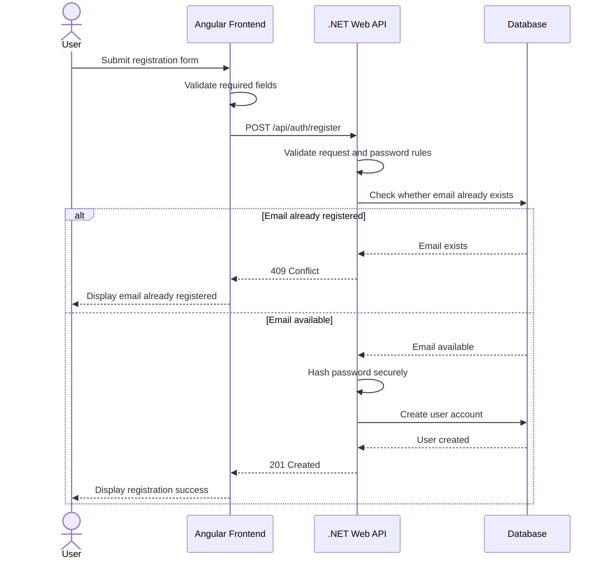
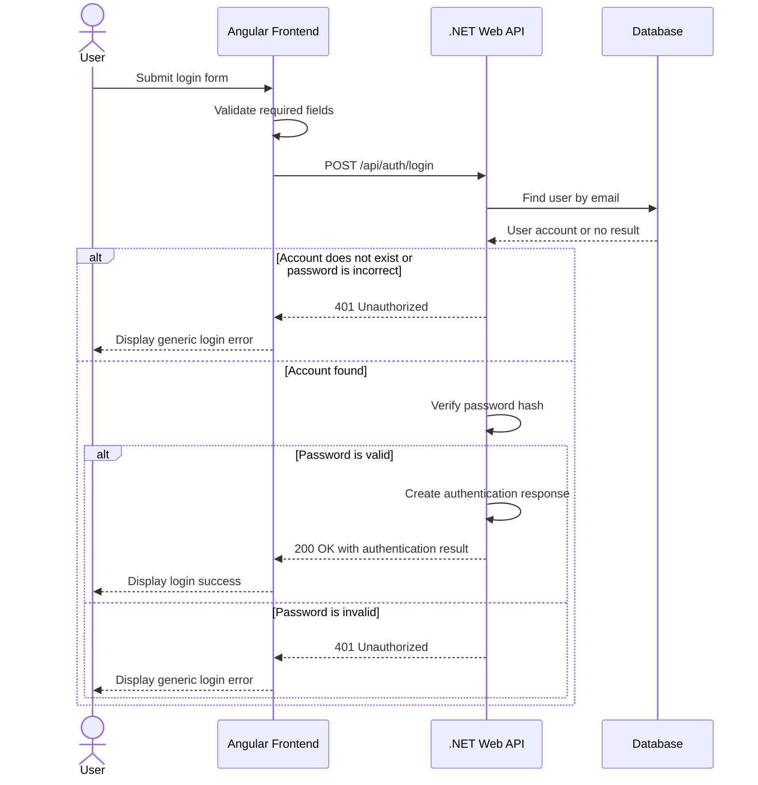
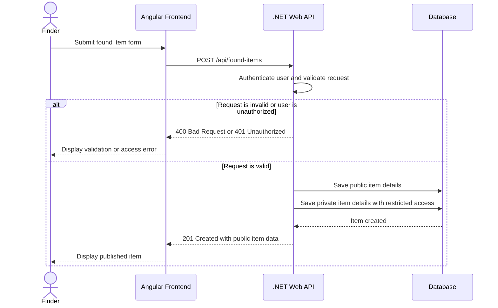
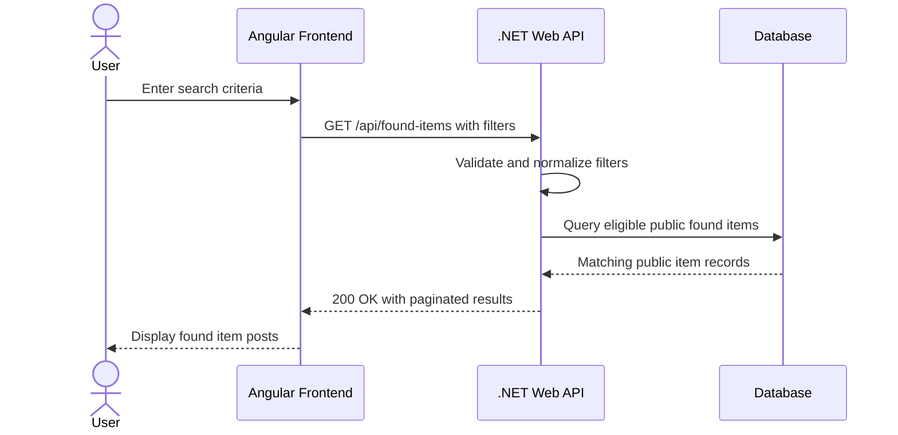
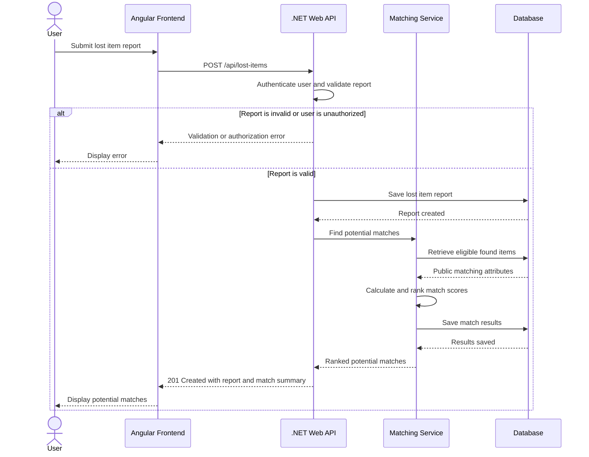
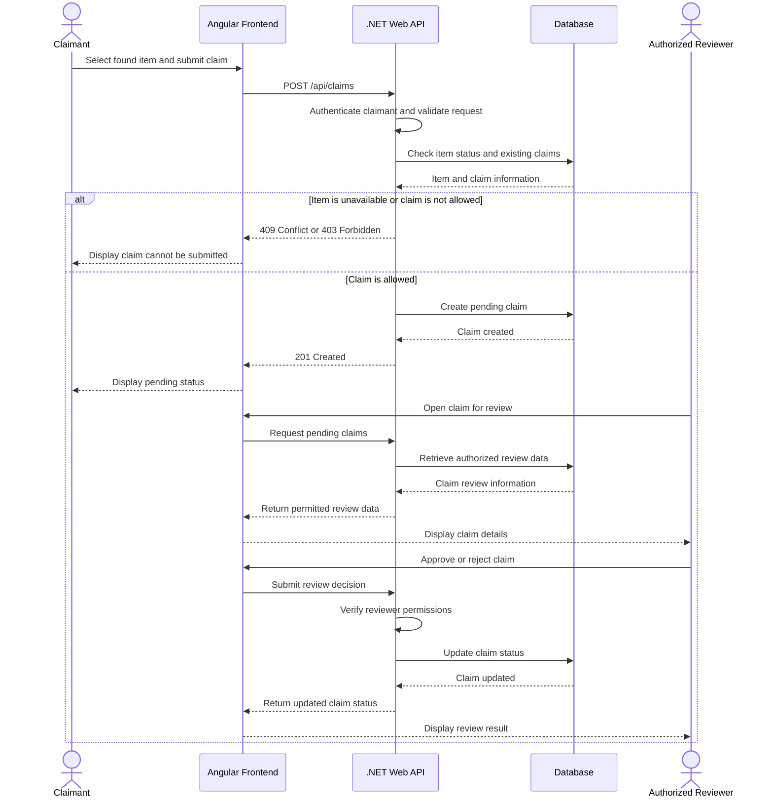
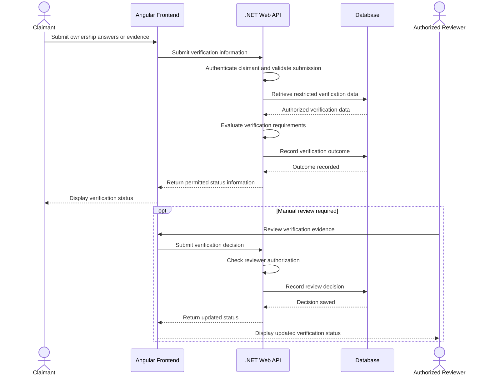
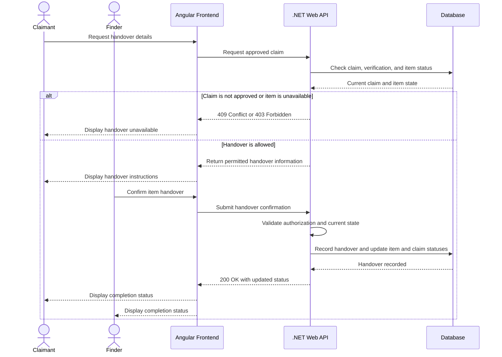

# Lost & Found Platform — Sequence Diagrams

This document describes the main interactions between users and the Lost & Found Platform.

The diagrams represent the intended business workflows and system responsibilities. They serve as a reference for the future Angular frontend, .NET Web API backend, and database implementation.

## 1. User Registration

This workflow describes how a new user creates an account.

**Business rules:**
- Email addresses must be unique.
- Passwords must never be stored in plaintext.
- The backend must validate registration data even if the frontend performs validation.
- The API must not expose sensitive account information in its responses.

## 2. User Login

This workflow describes how an existing user authenticates.

**Business rules:**
- The backend must verify the submitted password against its stored hash.
- Login errors should not reveal whether an email address exists.
- The authentication mechanism and token/session handling must be defined before implementation.
- Protected endpoints must enforce authentication and authorization.

## 3. Publish a Found Item

A finder submits an item that they have found. Public information is separated from private identifying details.

**Business rules:**
- Only authorized users may create found item posts.
- Public responses must not include private identifying details.
- Private details must be protected by backend authorization.
- The public and private records must be saved consistently.
- The initial item status and any moderation requirements must be defined in the business rules.

## 4. Search Found Items

A user searches the publicly available found item posts.

**Business rules:**
- Search results must contain public information only.
- Results should support pagination.
- Search filters may include category, color, approximate location, and date range.
- Private identifying details must not be returned in search results.

## 5. Submit a Lost Item Report and Generate Matches

If the user cannot find a suitable item, they submit a lost item report. The backend compares the report with eligible found item posts.

**Business rules:**
- A lost item report and a found item post are separate records.
- Matching identifies candidates; it does not establish ownership.
- The initial matching algorithm may use weighted rules based on category, color, approximate location, and date.
- Matching scores and thresholds must be defined separately from ownership verification.
- Matching must not disclose private details to unauthorized users.
- If no suitable matches exist, the report should remain available according to the agreed report lifecycle.

## 6. Submit and Review a Claim

A user submits a claim for a found item. The claim must be reviewed before the item can be handed over.

**Business rules:**
- A claim must reference an existing found item.
- Only authorized users may review claims.
- The claimant must not be allowed to approve their own claim.
- Claim submission does not automatically approve ownership.
- Valid claim statuses and rules for multiple claims must be defined before implementation.
- Approval must depend on the required ownership verification process.

## 7. Verify Ownership

Ownership verification uses private identifying details and, when necessary, additional evidence.

**Business rules:**
- Verification answers and evidence must not be publicly accessible.
- The system must not reveal the correct private answers through error messages.
- Verification criteria and approval thresholds must be defined explicitly.
- Manual review may be required for ambiguous or high-risk cases.
- The verification result must be recorded and associated with the relevant claim.
- Verification must be completed before handover authorization.

## 8. Complete Item Handover

After ownership is verified and the claim is approved, the handover can be recorded.

**Business rules:**
- Handover is permitted only after the claim is approved and ownership verification is complete.
- Only authorized participants may confirm a handover.
- Item and claim status changes must be performed consistently.
- A completed handover must not be duplicated.
- The system must retain a record of the completed handover.

## Implementation Notes

- These diagrams describe intended behavior, not implemented endpoints.
- Endpoint names and HTTP status codes are proposed and may be refined in the API specification.
- Database entities and transaction boundaries will be finalized during database design.
- Authentication, authorization, input validation, and privacy enforcement belong to the backend.
- Item, claim, and verification status transitions must be documented and enforced consistently.
- Error responses should avoid exposing private item details or sensitive account information.
